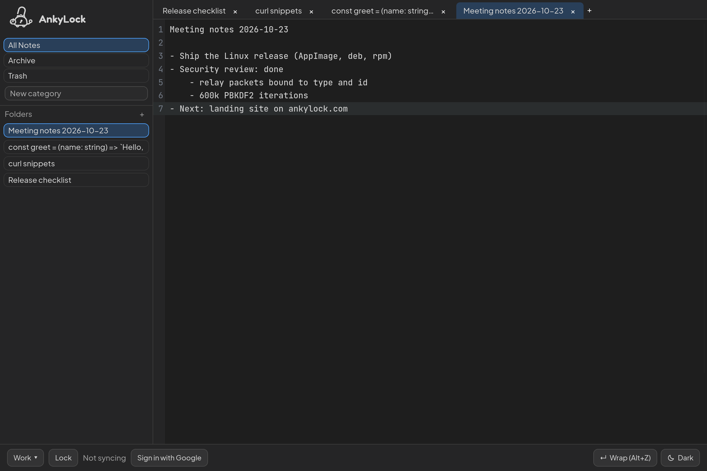
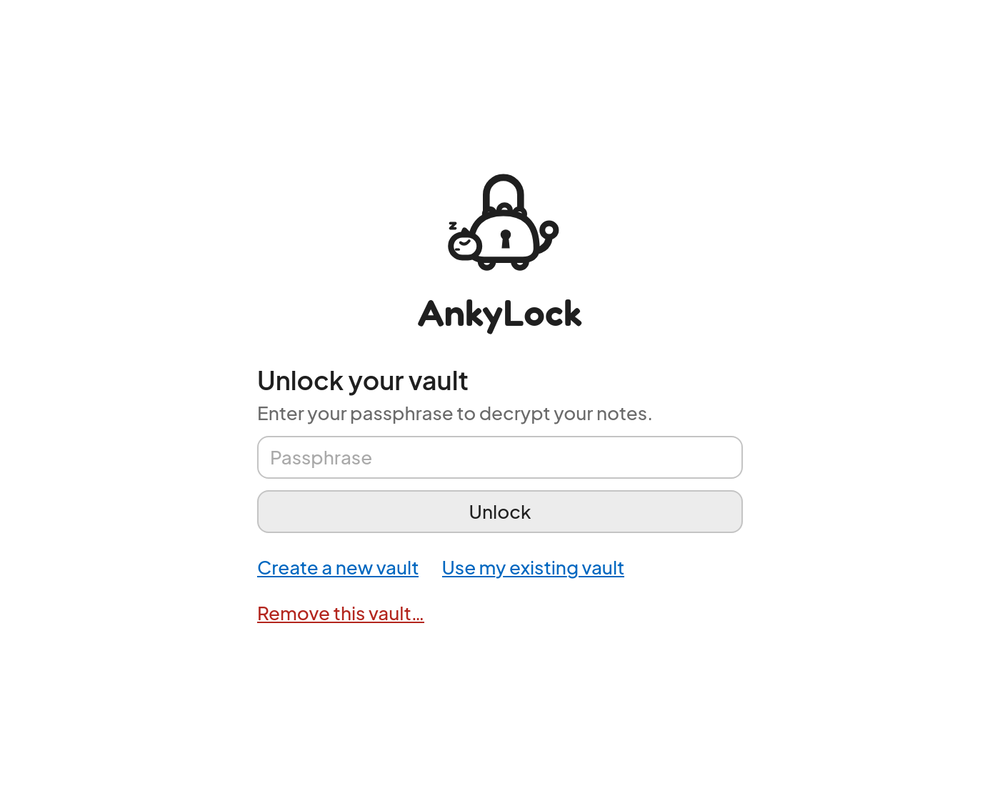

# AnkyLock

**A local-first, end-to-end encrypted scratchpad and notes app for developers.** Your notes are encrypted on your device with a key that only your passphrase can produce. Nobody else can read them: not Google, not a relay, not us.



> **Status:** pre-release. The first Linux release and the web app at `app.ankylock.com` are on their way; until then, build from source (below). The plan lives in [`TASKS.md`](TASKS.md), the functional specification in [`SPEC.md`](SPEC.md).

## What AnkyLock promises

- **Zero knowledge.** Every note, title, folder, category and vault name is encrypted with AES-256-GCM before it is saved or leaves the device. Google Drive and the optional relay only ever store or pass on ciphertext.
- **Your passphrase is the key.** The vault key is derived from your passphrase (PBKDF2-SHA-256, 600,000 iterations) at every unlock and lives only in memory. It is never stored, never sent, and never derived from your Google account. Lose the passphrase and the notes are gone: there is no recovery, by design.
- **Local first.** Everything works offline. Notes save instantly to the device; sync and backup happen in the background and never block typing.
- **No lock-in.** Export a note, a folder or a whole vault as plain text files at any time, optionally in an AES-256 protected zip.
- **Open source.** Everything that touches your data is in this repository, under the AGPL-3.0.

What it does not promise: protection against malware on an unlocked device, or against someone who knows your passphrase. The [threat model](docs/security/threat-model.md) spells out what is protected and from whom, and the [security review](docs/security/review-2026.md) lists what was checked and fixed.

## Features

- **Vaults:** keep notes apart in separate vaults, each with its own passphrase and key; one passphrase may open several. Vaults can be renamed, removed from a device or deleted everywhere, and removed even when their passphrase is forgotten.
- **Notes and tabs:** a new tab is an instant scratchpad (`Untitled-1`, …) that saves as you type; line 1 becomes the title. Notes are organized in folders (up to three levels) and categories, with All Notes, Archive and Trash. Trash empties itself after 28 days (configurable).
- **Editor:** CodeMirror 6 in JetBrains Mono, with word wrap (Alt+Z), Tab and Shift+Tab indenting, and clickable links (Ctrl+click, ⌘+click on macOS).
- **Sync across devices:** sign in with Google and each vault is backed up, encrypted, to AnkyLock's private folder in your Google Drive (the `drive.appdata` scope: AnkyLock cannot see the rest of your Drive). Your other devices merge those backups within minutes. Edits made at the same time on two devices merge through the Yjs CRDT, so neither is lost.
- **Instant sync (optional):** run your own relay and enter it in the desktop app; changes then reach your other devices immediately. See [Run your own relay](#run-your-own-relay).
- **Your data, your control:** export anything, delete a vault from Google Drive, or delete all of AnkyLock's Drive data and revoke its access in one step.
- **Comfort:** light, dark and system themes; English and Turkish; layouts for narrow screens and touch; an offline-capable web app (PWA).



## How it works

```
                 your passphrase
                       │  PBKDF2-SHA-256 (600,000 iterations, random salt)
                       ▼
 ┌──────────── device ─────────────────────────────────────────────┐
 │  vault key (non-extractable, in memory and in a crypto worker)  │
 │       │ AES-256-GCM, fresh random IV for every encryption       │
 │       ▼                                                         │
 │  notes, titles, names ──► encrypted local database              │
 └───────┬─────────────────────────────────────────────┬───────────┘
         │ sealed snapshots (every 5 min, on lock/exit) │ sealed packets (optional)
         ▼                                             ▼
  Google Drive appdata folder                 your own blind relay
  (ciphertext + a non-secret header)          (forwards ciphertext, stores nothing)
```

- **Encryption** uses the browser's Web Crypto API, in a dedicated worker, never a JavaScript crypto library. Every encrypted value is `iv (12 bytes) ‖ ciphertext ‖ tag (16 bytes)`.
- **A vault header** (salt, iteration count and an encrypted check value) lets a new device derive the same key from the passphrase. It holds no secret.
- **Sync** without a relay goes through Google Drive: each device uploads its own sealed snapshot of a vault, and the others merge it in (text through Yjs, folders and categories by the newest change, deletions as tombstones). With a relay, the same changes also travel as sealed packets in real time; their routing fields are bound to the encryption, so a relay cannot redirect or replay them onto other notes.
- **Desktop and web** share one UI (Solid.js). The desktop app is a Tauri v2 shell with SQLite storage and the OS keychain for the Google refresh token; the web app stores its encrypted data in IndexedDB.

## Download and install

Linux packages (AppImage, `.deb`, `.rpm`) will be published on [GitHub Releases](https://github.com/o-kangal/AnkyLock/releases) with SHA-256 checksums and build provenance, and the AppImage will update itself. Windows and macOS builds come later; until then, build them from source.

The web app will be served at `app.ankylock.com`.

## Build from source

Prerequisites: Node.js 20+, pnpm 9+, Rust 1.80+, and the [Tauri system dependencies](https://v2.tauri.app/start/prerequisites/) for your platform.

```bash
pnpm install --frozen-lockfile
pnpm --filter @ankylock/desktop tauri dev      # desktop app
pnpm --filter @ankylock/web dev                # web app on http://localhost:5173
pnpm -r run build && pnpm --filter @ankylock/desktop tauri build   # release builds
```

Without Google credentials the apps run local-only. To enable sign-in and Drive backup, create OAuth clients in the Google Cloud Console with the scopes `openid`, `email` and `https://www.googleapis.com/auth/drive.appdata`, then copy the `.env.example` files to `.env.local`:

- `apps/desktop/.env.local`: a client of type **Desktop app** (`ANKYLOCK_GOOGLE_CLIENT_ID`, `ANKYLOCK_GOOGLE_CLIENT_SECRET`). Google does not treat a desktop client's secret as confidential; it is compiled into the app, and sign-in uses PKCE.
- `apps/web/.env.local`: a client of type **Web application** (`VITE_GOOGLE_CLIENT_ID`) with the authorized JavaScript origin `http://localhost:5173` and the redirect URI `http://localhost:5173/oauth-callback.html`.

## Run your own relay

The relay is a small, stateless Rust server that forwards sealed packets between the devices of one Google account and vault. It authenticates each connection with the user's Google ID token, never reads or logs a packet's contents, and keeps nothing on disk.

```bash
GOOGLE_CLIENT_ID=<desktop client id>,<web client id> cargo run --release --manifest-path apps/relay/Cargo.toml
```

| Variable | Default | Meaning |
|---|---|---|
| `GOOGLE_CLIENT_ID` | (required) | OAuth client ids the ID tokens must be issued for, comma-separated: those of the AnkyLock build your devices run |
| `RELAY_BIND` | `0.0.0.0:8787` | Listen address |
| `RELAY_MAX_FRAME_BYTES` | 14 MB | Largest packet (a 10 MB note plus overhead) |
| `RELAY_CHANNEL_CAPACITY` | `32` | Packets buffered per vault before a slow device is disconnected |
| `RELAY_MAX_CONNECTIONS_PER_ACCOUNT` | `8` | Open connections per Google account |
| `RELAY_IDLE_TIMEOUT_SECS` | `60` | Silent connections are closed (apps ping every 25 s) |

Put it behind TLS (a reverse proxy) so devices connect with `wss://`, then enter the address, for example `wss://relay.example.com/ws`, in the desktop app under the vault menu → **Instant sync (own relay)**. The relay sees which notes change and when, but not what is in them; it also receives your short-lived Google ID token, so use only a relay you trust. The web app connects only to the relay it was built with (`VITE_RELAY_URL`), which keeps its content security policy strict.

## Repository layout

```
apps/
  desktop/   Tauri v2 shell (src-tauri: Rust host, SQLite, keychain)
  web/       Solid.js app and PWA; the shared UI
  relay/     Rust blind WebSocket relay
  site/      Static landing site (ankylock.com), pre-rendered in English and Turkish
packages/
  core/      Domain models and business rules
  crypto/    Web Crypto wrappers (AES-256-GCM, PBKDF2) and the crypto worker
  editor/    CodeMirror 6 setup
  storage/   Storage engine interface and adapters (SQLite, IndexedDB)
  sync/      Yjs documents, Drive backup and catch-up, outbox, relay client
migrations/  SQL schema migrations
tests/       End-to-end tests across devices; browser tests (Playwright) in tests/browser
docs/        Security documents, design sources, screenshots
```

## Development

Run from the repository root:

| Purpose | Command |
|---|---|
| Install | `pnpm install --frozen-lockfile` |
| Desktop dev | `pnpm --filter @ankylock/desktop tauri dev` |
| Web dev | `pnpm --filter @ankylock/web dev` |
| Landing site dev | `pnpm --filter @ankylock/site dev` |
| Relay dev | `cargo run --manifest-path apps/relay/Cargo.toml` |
| Type check | `pnpm -r run typecheck` |
| Lint | `pnpm -r run lint && cargo clippy --workspace --all-targets` |
| Tests | `pnpm -r run test && cargo test --workspace` |
| Browser tests (Chromium, WebKit) | `pnpm --filter @ankylock/e2e test:browser` |
| Build | `pnpm -r run build && pnpm --filter @ankylock/desktop tauri build` |
| Dependency audit | `pnpm audit && cargo audit && cargo deny check` |
| Third-party notices | `pnpm notices` |

[`CONTRIBUTING.md`](CONTRIBUTING.md) explains how to contribute, [`AGENTS.md`](AGENTS.md) holds the engineering rules, and [`SECURITY.md`](SECURITY.md) how to report a vulnerability.

### App icons

The sources are `apps/desktop/src-tauri/icons/app-icon.svg` and `app-icon-maskable.svg` (full-bleed, for the PWA). To regenerate every size after editing them:

```bash
cd apps/desktop
pnpm exec tauri icon src-tauri/icons/app-icon.svg            # desktop: .ico, .icns, PNGs
pnpm exec tauri icon src-tauri/icons/app-icon.svg -o /tmp/web -p 192 -p 512
pnpm exec tauri icon src-tauri/icons/app-icon-maskable.svg -o /tmp/maskable -p 512
# then copy /tmp/web/{192x192,512x512}.png to apps/web/public/icons/icon-{192,512}.png
# and /tmp/maskable/512x512.png to apps/web/public/icons/icon-maskable-512.png
# (delete the generated icons/android and icons/ios: mobile is out of MVP scope)
```

On Linux (GNOME/Wayland) the dock takes an app's icon from a `.desktop` entry matching the window's `StartupWMClass`, so `tauri dev` shows a generic icon until one exists. Installed packages ship that entry (`StartupWMClass=ankylock-desktop`). For development, copy `icons/128x128.png`, `icons/128x128@2x.png` and `icons/icon.png` to `~/.local/share/icons/hicolor/{128x128,256x256,512x512}/apps/ankylock-desktop.png` and create `~/.local/share/applications/ankylock-desktop.desktop` (named after the window's app id) with `Icon=ankylock-desktop`, `StartupWMClass=ankylock-desktop` and `NoDisplay=true`. GNOME caches icons by path, so after regenerating the icons copy them again and run `gtk-update-icon-cache -f -t ~/.local/share/icons/hicolor`; a new icon may only show after logging out and in.

### Releases

Releases are built in CI from a version tag and published to GitHub Releases; the steps and the required secrets are documented with the release workflow (Task 13g).

## License

AnkyLock is free software: you can redistribute it and/or modify it under the terms of the [GNU Affero General Public License](LICENSE), version 3 or (at your option) any later version. If you run a modified version for others over a network, for example a hosted web app or relay, you must offer them its source code.

Copyright © 2026 Onur Kangal. Third-party components and their licenses are listed in [`THIRD_PARTY_NOTICES.md`](THIRD_PARTY_NOTICES.md).
